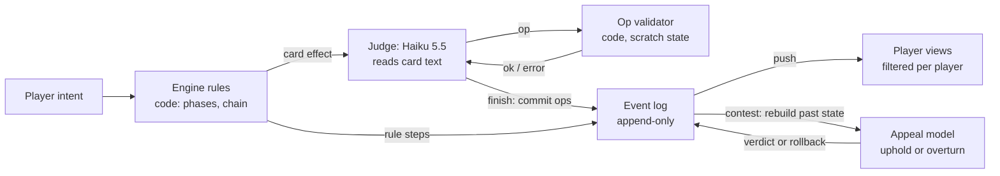

# Yu-Gi-Oh duel engine: architecture plan

As of 2026-11-18. Working copy with comments: [Claude Doc](https://claude.ai/artifact/FQocZyRCtBbmXHmBYGs869). This file is the version coding work follows.

## Summary

Code owns the game; the LLM only reads card text. Everything that is the same for every card (turn structure, zones, LP, battle, the chain stack, priority, once-per-turn tracking) is ordinary deterministic code. The LLM does the one job code can't do cheaply: turn a card's English text into game actions.

It does that in two places:

1. **Offline, once per card**, a strong model compiles each card's text into a structured *effect sheet* (effect type, spell speed, cost vs effect, OPT clause, activation condition in plain words). Sheets are stored, reviewable and fixable.
2. **At runtime**, Claude Haiku 5.5 acts as judge: it checks whether an activation is legal right now and resolves effects by calling a small, fixed set of *ops* (move card, change LP, modify ATK, ask a player to choose, ...). Code validates every op before applying it.

Every state change is an event in an append-only log, so any past decision can be replayed, contested by a stronger model, and rolled back. Overturned decisions become curated *rulings*, retrieved by card ID into future prompts, and *test cases* in an eval suite.

Deck building, accounts, premade decks and challenge links live outside the engine and only talk to it through "start a match with these two decklists".

## What the Gemini outline gets right, and where it breaks

The outline's instincts are good, but "dumb state, LLM judges everything" puts the model in charge of exactly the parts it is worst at.

**Keep:**

- Never trust the model's memory of card text. Inject exact text from a local card DB.
- State lives in code, not in the conversation.
- Force structured output; never parse narration.
- Cache the rules reference. (With Haiku 5.5 at $0.10 per million input tokens, cost is not the worry; caching mostly buys latency.)

**Change:**

- **Too much is judged by the LLM.** Phases, Normal Summon limits, battle damage, chain resolution order, priority and OPT counting are finite, generic rules. Code gets them right every time, instantly, for free. A non-reasoning Haiku will occasionally get them wrong, and every wrong call is a contest.
- **A free-form state patch is unsafe.** If the model writes arbitrary `state_mutations`, nothing stops it teleporting cards, editing hidden zones or changing LP by the wrong amount. It should instead call a closed set of ops that code checks (the card is really in that zone, the zone has space, the target is legal).
- **Resolution is interactive, not one shot.** "Add 1 card from your Deck to your hand" needs the player to choose. One request in, one patch out can't express that. A short tool loop can: the model calls `ask_player`, code pauses, the answer comes back.
- **It skips the hardest part: responses.** Most Yu-Gi-Oh complexity is who may respond to what, and when (chains, triggers, hand traps, "missing the timing", SEGOC). The outline only describes "an action, then a patch". The response window has to be a first-class concept in code.
- **Lingering and continuous effects drift.** "Monsters you control gain 500 ATK" or "you cannot Special Summon for the rest of this turn" must persist after the card's resolution. They need a home in state, not just in the model's last reply.
- **Per-action prompts are slow to compile.** Re-reading every card's full text on every action to work out spell speed and OPT is wasted work; that analysis is the same every time, so do it once per card (the effect sheets).

## Code vs LLM: who owns what

The rule of thumb: if a rule is the same for every card, it is code; if it depends on what a specific card's text says, the LLM reads it and code enforces the result.

| Concern | Owner | Notes |
| --- | --- | --- |
| Turn order, phases, steps, draw, hand size | Code | Fixed by the rulebook |
| Zones, card instances, positions, face-up/down, visibility per player | Code | Single source of truth; hidden info filtered per player |
| Normal Summon/Set count, tributes, Extra Deck summon procedures (Fusion, Synchro, Xyz, Link, Pendulum) | Code | Generic mechanics; card-specific *materials* read from the effect sheet |
| Battle: attack declaration, damage step, damage calc, LP | Code | Pure arithmetic once modifiers are known |
| Chain stack, spell speeds, priority passing, LIFO resolution | Code | Spell speed comes from the effect sheet |
| OPT / HOPT bookkeeping | Code | The sheet says *which kind* of OPT; code counts uses by card name + effect index |
| Banlists and deck legality | Code | Banlists are data; checked when a deck is saved and when a match is joined |
| Stat modifiers and lingering restrictions | Code stores and applies; LLM creates them | Created via ops, expire on a stated boundary (end of turn, while face-up, ...) |
| Parsing a card's text into effects | LLM, offline | Effect sheets, see next section |
| "Is this activation legal right now?" (conditions, costs payable, valid targets) | LLM at runtime, code double-checks what it can | Code checks costs and target zones; LLM judges text conditions |
| Resolving an effect | LLM at runtime, via ops | Every op validated by code |
| Which triggers fire after an event | Code | Each sheet's `when` names its event; see chains.md |
| Explaining a ruling, handling a contest | Stronger LLM | Only on demand |

This keeps the LLM's job small and checkable: read text, pick ops. It never decides what phase it is or how much damage an attack does.

## Card compilation: one effect sheet per card

Each card is analysed once, offline, into a structured effect sheet; this is the "no tens of thousands of handlers" answer. The sheet is data produced by a model, not code written by hand, and it is the first place to fix a card that keeps getting judged wrong.

A sheet holds, per effect on the card:

- **Kind:** ignition, trigger (mandatory or optional, "when" vs "if"), quick, continuous, flip, or summoning condition / procedure.
- **Spell speed** (1, 2 or 3).
- **OPT clause:** none, soft OPT, hard OPT by name, or shared ("you can only use 1 of these effects per turn").
- **Activation window** in plain words ("when this card is Normal Summoned", "during either player's turn").
- **Cost** text and **effect** text, split on the colon and semicolon rules.
- **Targets?** and what kind.
- Materials or summon procedure for Extra Deck monsters.

How it is built:

1. Run a strong model (Sonnet 5.5 or Opus 5.5 with thinking on) over each card's text through the Batches API, which costs half and is fine because nothing waits on it.
2. Output is a strict JSON schema (structured outputs), so every sheet parses.
3. Store it next to the card with the card's text hash. If errata changes the text, the hash changes and the card is recompiled.
4. Sheets can be reviewed and hand-corrected; a corrected sheet is marked *verified* and never overwritten.

Start with only the cards in the premade decks, so the first sheets are a few hundred cards you can actually read, not 13,000.

## Runtime judge: ops, tool loop, validation

The judge is a short tool-use loop where each tool is one op. Code applies each op to a scratch copy of the state, returns success or a precise error, and only commits when the model calls `finish`. A rejected op goes back to the model as an error it can correct, so most mistakes are caught before a player sees them.

Generic rules never reach the model; only card effects do, and nothing the judge proposes touches the board until code accepts it.

**Two judge calls:**

- `check_activation`: player wants to activate effect N of card X (with these targets / costs). Returns legal or illegal plus a one-line reason. Costs are paid by ops in the same call.
- `resolve_chain_link`: resolve this link against the current state. Returns ops, ending in `finish`.

**Starting op vocabulary** (closed set, grows only when a real card needs it):

| Op | What code validates |
| --- | --- |
| `move(card, to_zone, position?, face?)` covers draw, add to hand, send to GY, banish, return, shuffle into Deck | Card exists where the model says; zone has space; Extra Deck rules |
| `special_summon(card, zone, position)` | Zone free; summon not blocked by an active restriction |
| `destroy(card, reason)` / `tribute(card)` | Card is on the field |
| `change_lp(player, delta, kind: damage / cost / gain)` | Cost can't exceed current LP |
| `modify_stats(card, atk, def, until)` | Card face-up on field; `until` from a fixed list |
| `change_position(card, position)` | Card on field |
| `negate(chain_link, what: activation / effect)` | Link exists and is unresolved |
| `negate_card_effects(card, until)` | Card face-up |
| `add_restriction(player, text, until)` | Stored as a lingering effect; shown in later prompts |
| `counters(card, type, delta)` / `attach(card, xyz)` / `detach(xyz, n)` | Card on field; enough counters/materials |
| `reveal(cards, to)` | Cards exist |
| `ask_player(player, prompt, options, min, max)` | Pauses the loop; options must be real cards or choices |
| `finish(summary)` | Ends the call; summary is shown in the log |

All card references are instance IDs that code assigned, never names, so the model can't invent a card.

**What goes in each request** (order matters for prompt caching):

1. *Cached:* tool definitions, then the system prompt with the rules reference (fast-effect timing, chain and SEGOC rules, cost vs effect punctuation, damage step rules).
2. *Per request:* the current state as compact JSON (hidden zones as counts unless relevant), the effect sheets and exact text of the cards involved, active lingering effects, retrieved rulings (see below), and the request itself.

**Model settings for Haiku 5.5:** strict tools (`strict: true`) so every op parses; thinking off is allowed on Haiku 5.5 only at effort `high` or below, so that is the setting for "reasoning off". Measure it against adaptive thinking at `low` effort on the eval suite before deciding, because a few hundred milliseconds of thinking may remove a lot of contests. Assistant prefill is not supported, which the tool loop doesn't need anyway.

**Hidden information:** the judge sees everything, but players only see what code renders from ops ("Player 1 added 1 card from Deck to hand"). The model's free text is never shown to the opponent directly, so it can't leak a hand or a set card.

**Response windows:** every window stays open for at least a fixed floor (about 1 to 2 seconds) plus small random jitter, whether or not the player holds anything that could respond, so the speed of a pass reveals nothing. Players can set a default response per card, in hand and on the field; the floor still applies, so defaults reveal nothing either.

## Action log, contests and rollback

The match is an append-only list of events, and the board is computed by replaying them. That one decision makes "look at the state as it was" and "roll back" trivial instead of a special feature.

**Event types:**

- `PlayerIntent`: what a player asked for (activate, summon, attack, pass, answer a prompt).
- `JudgeDecision`: the full judge call, stored verbatim: model ID, prompt version, input state hash, every tool call and result, the final ops. This is what a contest re-examines.
- `OpsApplied`: the validated ops that actually changed the board.
- `EngineStep`: deterministic code moves (phase change, draw, battle damage).

State at any point = replay the events up to that point. Store a snapshot every turn so replay stays fast.

The log the players see is rendered from these events: each player action, then each automated response under it, each with a **Contest** button.

**Contest flow:**

1. A player contests a `JudgeDecision`, optionally with a sentence ("Ash Blossom can't negate this, it doesn't add from Deck").
2. Code rebuilds the exact state before that decision and sends it, the original decision and the player's note to a stronger model (Sonnet 5.5 or Opus 5.5 with thinking on).
3. The appeal returns either **upheld** with an explanation, or **overturned** with corrected ops and an explanation.
4. If overturned, both players see a rollback offer: rewind to just before that decision, apply the corrected ops, and discard everything after it. Later actions can't be safely replayed on a different board, so they are dropped, not re-applied.
5. Either way, the contest and its outcome are stored as a *candidate ruling* (next section).

A rollback needs both players to agree. The appeal's explanation is one or two sentences written for both players, and code rejects it if it names any card still hidden from either of them.

## Rulings memory and the eval suite

Feeding every past contest into every prompt would bloat context and nudge the model toward unrelated rulings. Retrieve by card ID instead, and only from rulings someone has confirmed.

**A ruling record:** the card IDs involved, mechanic tags (`missing-the-timing`, `segoc`, `damage-step`, ...), a short situation, the correct ruling in one or two sentences, the source (contest, official ruling, manual), and a status: *candidate*, *verified* or *rejected*.

**Retrieval:** for each judge call, inject verified rulings whose card set is entirely contained in the cards present in the prompt, plus at most a few mechanic-tagged general rulings when the event matches the tag. Card-ID matching is exact, cheap and explainable; no vector search needed at the start. If rulings ever number in the thousands per card, add embeddings then.

**Why "verified" matters:** players contest wrongly too, and a stronger model can also be wrong. A candidate becomes verified when (a) both players accepted the appeal outcome and a second appeal run agrees, or (b) the admin approves it in a small review page. Only verified rulings reach prompts.

**Where a fix belongs:** if the mistake is about one card (wrong spell speed, wrong OPT), fix its effect sheet. If it's about an interaction between cards, it's a ruling. If it's about a general rule the model keeps missing, improve the rules reference.

**Eval suite:** every verified ruling is also a test case: a saved state, an intent, and the expected outcome (legal/illegal, or the expected ops). Run the suite on any change to the prompt, rules reference, op vocabulary or model setting, to see whether a tweak helped or broke something else. This is the "training" loop, and it needs no fine-tuning.

## Card data

Pull the whole YGOPRODeck database once into our own database and serve everything from there; the game never calls the API live.

- **Source:** YGOPRODeck API v7 (`cardinfo.php`) returns every card with ID, name, type, text, ATK/DEF, level/rank/link, attribute, race, archetype, and banlist status in one response.
- **Refresh:** a scheduled job checks the API's database-version endpoint and re-imports when it changes. Text changes trigger effect-sheet recompilation (via the text hash).
- **Images:** download once and serve from our own storage or CDN. YGOPRODeck's API guide (checked 2026-11-18) asks clients to store data locally, stay under 20 requests a second (or be blocked for an hour), and download and re-host images instead of hotlinking them. The importer follows all three.
- **Rulings source:** YGOPRODeck has card text, not rulings. Official rulings would have to come from elsewhere (for example the Yugipedia or ygoresources rulings databases). Their terms need checking before importing anything; until then rulings come only from contests and manual entry.

## The product around the engine

The engine is a library with one entry point: given the event log and a new player intent, produce new events. It knows nothing about accounts, lobbies or websites. Everything below sits outside it.

| Module | Does | Talks to the engine by |
| --- | --- | --- |
| Card service | Imported card DB, search, images, effect sheets | Engine reads card text and sheets from it |
| Deck builder | Search and filter cards, main/extra/side limits, banlist check, import/export `.ydk` | Hands a validated decklist to a match |
| Banlists | User-customizable lists; a match records which one it was played under | Checked at deck save and match join |
| Premade decks | A handful of curated decklists, stored as normal decks owned by the system | Same as any deck |
| Lobby and challenge links | Create a match, get a link, opponent opens it and picks a deck | Starts a match with two decklists and a seed |
| Match server | Hosts running matches, holds the event log, runs the judge, pushes updates | Calls the engine; server is the only authority |
| Client | Board UI, log with Contest buttons, prompts for choices | Sends intents, receives a per-player view (opponent's hand hidden) |
| Accounts | Sign-in, admin approval, guests, saved decks, match history | Not needed by the engine at all |

**Access:** private and invite-only; the owner pays for model calls. New accounts wait for admin approval. Anonymous users can play with a premade deck only as a guest, by accepting a challenge link from an approved user; otherwise they are read-only. Building decks needs an approved account. Each match has a cap on judge and appeal calls.

**Multiplayer sync:** server-authoritative. Clients send intents with a plain POST; the server appends events and pushes each player their own filtered view over Server-Sent Events. (Layer 1 chose SSE over WebSockets: traffic is one intent up and one view down, SSE rides the same cookie login as the rest of the API, and the browser reconnects by itself.) Because the log is the source of truth, a reconnecting client just gets the current view again. Shuffles use the server's secure RNG and the shuffled order is stored in the log, so replays are exact.

**Stack:** TypeScript on both ends, so the state, intent and op types are shared. Zod schemas for ops serve three jobs at once: the tool definitions sent to Claude, runtime validation, and client types. Postgres for cards, decks and the event log. The official Anthropic TypeScript SDK for Claude calls.

**Frontend:** React + Vite (the duel screen's design is in [duel-ui.md](duel-ui.md)). A card table is a few dozen to about 100 images on screen, not thousands of sprites, so the regular DOM is fast enough and keeps card text, tooltips and accessibility easy. [Motion](https://motion.dev) (formerly Framer Motion) gives spring physics, drag, and layout animations, which is what makes the other cards in hand slide aside when one is reordered (`layout`). The same Motion drag also carries cards from the hand to the field; the zone under the pointer is found with the browser's own `elementsFromPoint`, so no separate drag-and-drop library is needed (see duel-ui.md). PixiJS (WebGL canvas) is the step up if particle effects or a 3D table are ever wanted, at the cost of building text and UI inside the canvas.

## Build order

Each layer ends with something two people can play in a browser, and each adds one capability on top of a working game. The server-authoritative event log is there from layer 1, because retrofitting it later would mean rewriting the engine.

1. **Vanilla duel over a link.** Card import (data only), event-sourced engine with phases, draw, Normal Summon/Set, tributes, battle, LP and win by LP 0 or deck-out. Server with live updates, a challenge link, a plain board UI. No LLM yet.
   - Playable when: two browsers can finish a duel.
   - Built 2026-11-18 (see [duels.md](duels.md)). It plays the two starter decks unchanged rather than Normal-Monster-only decks, which would be too small: effect monsters fight as plain bodies and Spells and Traps can only be Set until layer 2.
2. **Effects via the judge, no responses yet.** Effect sheets for the starter decks' main-deck cards, `check_activation` and `resolve_chain_link` with the op tool loop and validation, `ask_player`. Covers Special Summons from hand and GY, banishing, targeting cards in the GY, and conditions that check what is on the field. Opponent can't respond yet. A first eval suite of about 20 hand-written cases. A bare Contest button that runs the appeal and shows the explanation (no rollback yet).
   - Playable when: the starter decks' spells and ignition effects work end to end.
   - Built 2026-11-19 (see [effects.md](effects.md)). Two choices beyond this plan: effect sheets started as JSON files in the repository (since 2026-11-19 they live in Postgres with every revision kept, seeded from those files, so players' reports can flag them at once), and a Spell/Trap whose sheet has a continuous effect waits for layer 5 rather than being half-applied.
3. **Synchro and Xyz summoning.** Extra Deck zone, Tuner and non-Tuner level sums, Xyz materials of the same Level, overlay units (`attach` / `detach`), materials read from effect sheets, summoning to a Main Monster Zone. Both procedures are generic rules, so they are code, not judge calls.
   - Playable when: each starter deck can make its Synchro and Xyz plays.
4. **Chains and responses.** Spell speeds, chain stack, priority passing, response windows with the timing floor and per-card defaults, traps and quick-play spells, OPT tracking.
   - Playable when: a trap can respond to a summon and a counter-trap can respond to that.
   - Built 2026-11-19 with layer 5's triggers (see [chains.md](chains.md)), without Counter Traps, negation or per-card defaults.
5. **Triggers and lingering effects.** Event list after each resolution, trigger detection by the judge, mandatory vs optional triggers, SEGOC ordering, stat modifiers and restrictions with expiry. Synchro decks lean on "when this card is Summoned" triggers, so this layer matters early for them.
   - Playable when: both starter decks play out their normal lines without manual fixes.
   - Triggers, SEGOC and "becomes" stat changes built 2026-11-19 with layer 4. Code detects triggers from the `when` in each sheet, not the judge. Continuous effects and lingering restrictions are next.
6. **Rollback and rulings memory.** Overturn plus two-player rollback consent, hidden-info check on explanations, candidate/verified rulings, retrieval into prompts, admin review page, every verified ruling added to the eval suite.
7. **Remaining Extra Deck mechanics.** Fusion, Link (and the Extra Monster Zone rules that come with it) and Pendulum, each added when a premade deck needs it.
8. **Product.** Custom banlists, deck builder with banlist validation and `.ydk` import, more premade decks, match history. Widening the card pool happens here, gated by eval results per archetype. Accounts, Auth0 login, admin approval and guests are being built separately and ahead of the engine, since they don't depend on it.

The riskiest assumption, that Haiku can resolve real card text through ops reliably, is tested in layer 2, before most of the investment.

## Starting decks

The first card pool is two starter decks, used as the premade decks, unchanged:

| Deck | Teaches | Mechanics the engine must cover |
| --- | --- | --- |
| Yu-Gi-Oh! 5D's Starter Deck 2008 | Synchro Summoning | Tuners and level sums, Special Summons, banishing, targeting cards in the GY, effects that check what is on the field |
| Starter Deck: Dawn of the Xyz | Xyz Summoning | Xyz materials of the same Level, overlay units, detaching as a cost |

What this changes in the build order: Synchro and Xyz move up to layer 3, right after the judge works, while Fusion, Link and Pendulum wait until a deck needs them. Neither deck needs Link Monsters, so under the current rules every Extra Deck monster they use can go to a Main Monster Zone, or to an empty Extra Monster Zone (built 2026-11-19, see [roadmap.md](roadmap.md)).

The exact decklists are imported from the card database by set (YGOPRODeck can filter cards by set name; to verify when the importer is written), so no list is typed by hand. The cards keep their current official text, which may differ from the 2008 printing.

## Decisions

Decided 2026-11-18.

| Topic | Decision |
| --- | --- |
| Card pool | Start with one or two premade decks; widen only as trust in the engine grows |
| Starting decks | 5D's 2008 Starter Deck (Synchro) and Starter Deck: Dawn of the Xyz (Xyz) |
| Formats and banlists | Banlists are user-customizable data, enforced by code at deck save and match join |
| Response windows | Fixed minimum window plus jitter to hide timing; per-card default responses |
| Rollback | Both players must agree; one or two sentence explanation that reveals no hidden info |
| Stack | TypeScript end to end; React + Vite + Motion on the frontend |
| Accounts | Anonymous play with premade decks as a guest through a challenge link; account needed to build decks |
| Access and cost | Owner pays; invite-only; new accounts need admin approval |
| Docs | Plans live as Markdown under `docs/` |

## Still open

- A rulings source (see Card data). YGOPRODeck's terms were checked on 2026-11-18.

## Deferred: draft mode

Requested by several players, mechanics undecided, not scheduled until well after layer 7. A draft series would be run like a campaign or tournament, and players build decks only from the cards they drafted. It sits entirely outside the engine: the deck builder checks a deck against the player's drafted pool the same way it checks a banlist, and the engine still just receives two decklists.
