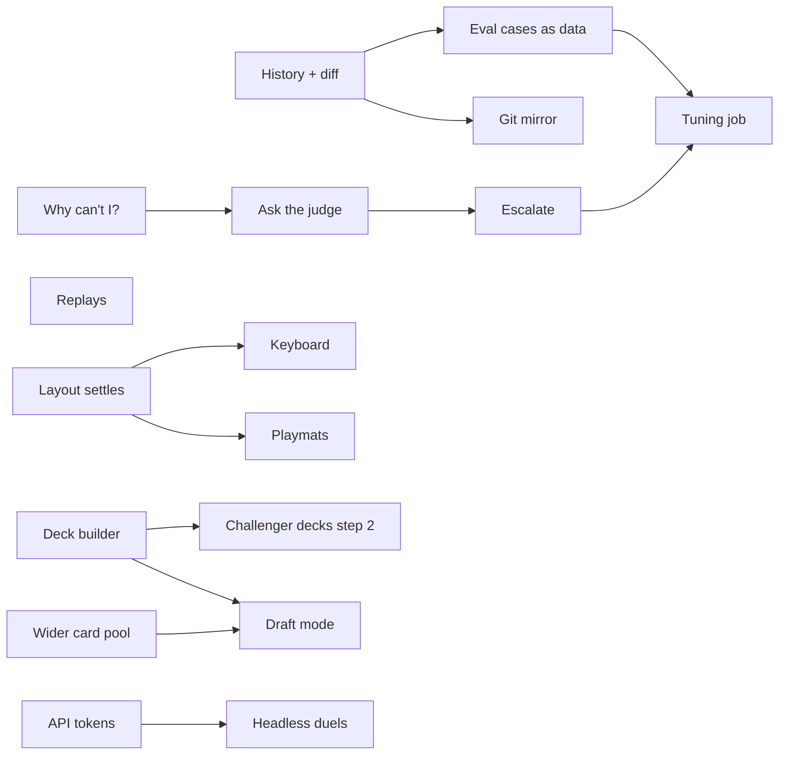

# Next steps after the starter decks

Written 2026-11-19, while both starter decks are being playtested. Everything in [roadmap.md](roadmap.md) is built, and nothing here is built yet. The AI opponent's deck plans (step 3 of [ai-opponent.md](ai-opponent.md)) wait on playtest results and aren't covered here.

The three features coming next have their own plans:

- [ask-the-judge.md](ask-the-judge.md): players ask rules questions during a duel, and can escalate an answer into a contest or a report.
- [keyboard.md](keyboard.md): a whole duel without a mouse.
- [rulings-history.md](rulings-history.md): history and diffs of effect sheets, a git mirror on the server, eval cases as data, and an Opus job that proposes sheet fixes.

The rest are lighter sketches below: replays, custom playmats, challenger-chosen deck lists, draft mode, and a headless mode with a public API. Each gets a full plan when it comes up.

## Suggested order

Each item leaves the site working and is useful alone.

1. **"Why can't I?" and Ask the judge** (steps 1 and 2 of [ask-the-judge.md](ask-the-judge.md)). Most useful while playtests are running: it answers "nothing happened" confusions without an appeal, and "Why can't I?" costs nothing per use.
2. **Rulings history and the git mirror** (steps 1 and 2 of [rulings-history.md](rulings-history.md)). Small, and it keeps playtest fixes from being lost to resets.
3. **Escalating a question** (step 3 of ask-the-judge.md). Builds on 1 and on the existing contest and report flows.
4. **Replays** (below). Small, since the event log already holds everything, and it makes playtests easier to review.
5. **Eval cases as data, then the tuning job** (steps 3 and 4 of rulings-history.md). Better after some weeks of play, when there is evidence to tune from.
6. **Keyboard controls** ([keyboard.md](keyboard.md)), once the board layout settles after playtest fixes.
7. **Custom playmats**, after the layout settles too.
8. **Challenger-chosen deck lists**, step 1 with premade decks; step 2 needs the deck builder.
9. **Headless mode and public API.**
10. **Draft mode**, last: it needs the deck builder and a much wider card pool.

## Not planned yet: the deck builder

Two items below need custom decks, and the deck builder (architecture layer 8: search, Main/Extra limits, banlists, `.ydk` import) has no detailed plan yet. It isn't in this document's list, but it has to come before challenger decks step 2 and draft mode. A wider card pool comes with it: every card a player can put in a deck needs a compiled sheet and eval coverage, so the pool grows in batches Ethan picks, as architecture.md already says.

## Replays

The event log already holds every duel, and `viewFor` gives any seat's view after any event, so a replay is the board fed past views.

- **Page:** `/duel/:id/replay`, for a finished duel. Step back and forward by event or by turn, or play at a chosen speed. It is the same `Board` in read-only mode, fed the same `steps` the live stream sends, so every animation already works. Rewinds after overturned appeals show as they happened.
- **Server:** `GET /api/duels/:id/replay?seat=0` returns the whole duel as steps for that seat: the log and the view after each visible event. The server builds it from the log, so hidden cards stay hidden exactly as they did live. A long duel is a few hundred steps, around a megabyte before gzip.
- **During a duel:** clicking an old log entry shows the board as it was then, in an overlay (duel-ui.md step 7). Same endpoint, cut off at that entry, for the asking seat only.
- **Admins** get the same page with every card face up (a view that hides nothing), which is easier to read than the Full log.

| Question | Recommendation | Other options |
| --- | --- | --- |
| Who can watch a finished duel | Its two players and admins | Anyone with the link |
| What players see | Their own seat's view, hidden cards stay hidden | Everything face up once the duel is over |

## Custom playmats

- **Upload** on the account page: PNG, JPEG or WebP up to 4 MB, resized on the server to a fixed size (with `sharp`) and stored on the image volume next to the card images. The account's setting points at it. A **template** download shows the zone outlines and the safe area, to line a design up in an image editor.
- **On the board** the mat is drawn under a player's half of the table, with the zone outlines still on top (lighter). Mats are for the landscape layout; portrait phones keep the plain table, since its proportions differ too much for one template.
- Guests have no mats. An admin can remove one.
- Needs the layout to have settled, since the template is the layout.

| Question | Recommendation | Other options |
| --- | --- | --- |
| Whose mat is shown | Each player's under their own half, as at a real table | Only your own mat, on your screen |
| Making mats on the site | Upload only | A simple maker (colour, image, text) on the site too |

## Challenger-chosen deck lists

Today the challenger picks their own deck, and the opponent picks any premade deck when they accept.

- **Step 1 (premade decks, now):** when making a challenge, the challenger picks which decks the opponent may choose from: any subset of the premade decks, at least one. Stored as `matches.allowed_decks`; joining refuses any other deck, and the join page offers only those, preselected when there is just one.
- **Step 2 (with the deck builder):** the challenger may also offer their own saved decks, or allow "any deck that is legal under this banlist". The banlist is recorded on the match, and the join check uses the deck builder's legality check. This is the "custom rulesets" idea from 2026-11-18.

| Question | Recommendation | Other options |
| --- | --- | --- |
| When the challenger offers one of their own decks | The opponent sees its name only; the list shows in the duel as cards are played | Show the full list on the join page, like the premade decks |

## Draft mode

Requested by several players; mechanics still undecided (architecture.md). The engine doesn't change: drafting decides which cards a player may build with, and the deck builder checks a deck against the player's pool the way it checks a banlist.

- **The pool is a cube, not the whole card database.** Every draftable card needs a working sheet and eval cases, so a draft uses a fixed list Ethan picks (say 180 to 360 cards), compiled and checked ahead of time, with only mechanics the engine supports (today that rules out Fusion, Link and Pendulum).
- **Format, simplest first:**
  1. *Sealed:* each player gets random packs from the cube and builds from them. No drafting at the same time, works for any number of players at their own pace.
  2. *Two-player draft* (Winston or grid style): two players take turns choosing from shared piles, asynchronously.
  3. *Booster draft:* 4 to 8 players pass packs around; needs everyone online at once.
- **A series** (campaign or tournament): a named event with its players, each player's pool, their decks, the duels between them and standings.
- Needs: the deck builder, a cube of compiled and checked cards, and an event page.

| Question | Recommendation | Other options |
| --- | --- | --- |
| First format | Sealed | Two-player draft; booster draft |
| What the cube holds | Cards whose mechanics the engine supports, chosen by Ethan | Grow the engine first (Fusion, Link) for a broader cube |

## Headless mode and public API

What exists: the engine is a library with no server inside it (`decide`, `evolve`, `legalActions`, `viewFor`); the browser plays a seat entirely over HTTP (intents, answers, contests, chat) and a Server-Sent Events stream; and the AI opponent proved a program can play a seat through the same calls.

- **Step 1, API tokens:** approved accounts create tokens on the account page. A token sent as a bearer header works on the existing `/api/duels/*` routes in place of the login cookie, so a bot plays a seat exactly as the browser does, and hidden information stays protected by the same per-seat views. A token may create challenges and accept them. Documentation: an OpenAPI file generated from the request schemas (Zod 4 has `z.toJSONSchema`) plus the shared types, published on the site. A rate limit per token.
- **Step 2, headless duels:** `POST /api/duels` with two token-held seats and no browser, for bot against bot: self-play, testing deck ideas, bot tournaments.
- **Step 3, the engine as a package:** publish `@yugioh/engine` with the effect sheets as data, for offline use. Scripted cards need no model; judged effects need a judge function the host supplies (the `ModelCall` interface).
- **Costs:** every judged effect in an API duel is a call on Ethan's Anthropic key, counted against the duel's judge calls like any duel.
- **Card data terms:** YGOPRODeck allows storing data and re-hosting images for this site. Serving card text and images to third-party apps through an API, or bundling sheets in a public package, needs a look at their terms first (and the cards are Konami's).

| Question | Recommendation | Other options |
| --- | --- | --- |
| Who gets tokens | Approved accounts only, like everything else | Open sign-up for developers |
| Who pays for judge calls in API duels | Ethan's key, with a monthly cap per token | Each token holder brings their own Anthropic key |
| The engine package | Private until the terms are checked | Public on npm |

## Decisions, all in one place

The full tables with the other options are in each plan.

| Feature | Question | Recommendation |
| --- | --- | --- |
| Ask the judge | Who sees questions | Only the asker |
| Ask the judge | Questions per duel | 20 per player, separate from judge calls |
| Ask the judge | When Escalate is offered | On every answer |
| Ask the judge | An escalation finds a card wrong | Flag its scripts at once, like a report |
| Ask the judge | Cost of an escalation | One of the duel's 10 appeals |
| Keyboard | Shortcut letters for the strip | Yes (P, N, E, L, T, Q) |
| Keyboard | Guard on End turn | None |
| Keyboard | Arrows while choosing | Only pickable cards and zones |
| Keyboard | Rebinding keys | Not now |
| Rulings history | Source of history | Database, git as a mirror |
| Rulings history | Mirror location | Bind mount at `/git/yugioh/rulings` |
| Rulings history | Tuner | Proposes only |
| Rulings history | Accept marks effects | `verified` |
| Rulings history | Tuner schedule | Nightly, 10 cards max, plus Tune now |
| Rulings history | Rulings for judge-only effects | A `rulings` list on the sheet effect |
| Rulings history | `RESET_SHEETS` off | At launch |
| Replays | Who can watch | The two players and admins |
| Replays | What players see | Their own seat's view |
| Playmats | Whose mat is shown | Each player's under their own half |
| Challenger decks | The opponent sees an offered custom deck | Its name only |
| Draft | First format | Sealed |
| Headless API | Who gets tokens | Approved accounts |
| Headless API | Who pays | Ethan's key, monthly cap per token |
